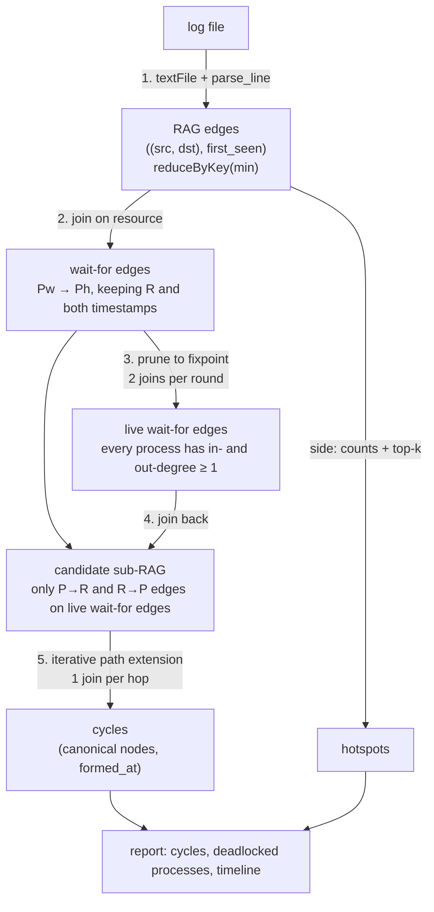

# Architecture — spark-deadlock-detector

The current design and the log of the decisions that produced it. The README's design notes
are written from this file.

---

## What this system does

It reads a log of resource-allocation events (`WAIT P R`: process P requests resource R;
`HOLD P R`: P has been granted R) and reports every deadlock in it. With single-instance
resources, a deadlock is exactly a cycle `P → R → P → R → … → P` in the Resource Allocation
Graph (RAG). For each cycle it reports its members and when it formed. It also reports the
deadlocked processes, a per-day timeline of deadlocks, and contention hotspots. All
graph work runs as Spark jobs, so the same code runs on a laptop (`local[N]`) or a cluster.

**Scope boundary — what it deliberately does not do:**
- **No release events.** An edge exists from its first appearance onward, so this is
  post-mortem analysis of a log, not live detection or deadlock recovery.
- **No multi-instance resources.** With multi-instance resources a cycle is necessary but not
  sufficient for deadlock, and you would need the banker's-style reduction instead.
- **Cycles longer than `--max-cycle-length` processes (default 13) are not searched for.**
- **Not streaming.** It processes one log per run.

---

## The diagram

**Reading it:**
1. Each line is parsed into one directed RAG edge. Duplicate edges collapse to their earliest
   timestamp.
2. A join on the resource turns `Pw → R` plus `R → Ph` into a wait-for edge `Pw → Ph`.
   Self-waits (`Pw == Ph`) are dropped.
3. A process with no outgoing or no incoming wait-for edge cannot be on a cycle. Such processes
   are removed repeatedly until nothing changes. What survives is every process on a cycle,
   plus any process sitting on a path between cycles.
4. Only the RAG edges that make up surviving wait-for edges are kept.
5. Every `P → R` edge seeds an open path. Each round joins the frontier (keyed by its last node)
   with the adjacency lists, extends each path one hop, and closes cycles that return to their
   start.

---

## Components

| Component | Responsibility | Spark operations |
|---|---|---|
| `parsing.py` | Line → `Event` → RAG edge; tolerant of tabs, spaces, trailing commas and either-order `HOLD` | none — pure Python, runs inside `map` |
| `graph.py` | RAG construction, wait-for join, fixpoint pruning, candidate subgraph | `reduceByKey`, `join`, `distinct`, `localCheckpoint` |
| `cycles.py` | Distributed cycle enumeration | `groupByKey` (adjacency), `join` + `flatMap` per hop, `collect` of closed cycles |
| `detector.py` | Pipeline order, caching, hotspots, timeline, timings | `countByValue`, `takeOrdered`, `cache` |
| `cli.py` | Arguments, report printing, JSON output | — |
| `scripts/generate_log.py` | Synthetic logs with a known number of deadlocks (every process deadlocked; kept for the §1 comparison) | — |
| `scripts/generate_realistic_log.py` | Realistic benchmark logs plus a ground-truth JSON file (every cycle, its formation time, the expected survivors of pruning) | — |

---

## Open forks — the upgrade phases

Each fork has a recommended option. Until a fork is decided, the recommendation is what gets built.

| # | Fork | Options (recommended first) | Why it matters |
|---|---|---|---|
| F1 | Single-machine baseline | **Decided — D10** | |
| F2 | Benchmark workload | **Decided — D9** | |
| F3 | DataFrame rewrite scope | **Decided — D11** | |
| F4 | Frontier join strategy | **Decided — D12** | |
| F5 | Cluster run | **(a) Docker Compose: 1 master + 2 workers, `spark-submit --py-files`** · (b) skip — local mode only | Shows the code is not tied to `local[N]`. All containers share one host, and that must be stated. **Cut for now** (first in the cut order; Docker is not installed in WSL) |
| F6 | CI | **Decided — D13** | |

---

## Decision log

Decisions D1–D8 were taken while rebuilding the coursework version (12 Oct 2026, commit
`2d30dae`). Each was **adopted by default and is open to override**.

### D1 — RDD API rather than DataFrames (for now)
**The fork:** which Spark API to express the graph algorithm in.

| Option | What it means in practice | Cost |
|---|---|---|
| RDDs (chosen) | Plain Python functions over key-value pairs, joins by hand | No Catalyst optimiser; every lambda round-trips through Python workers |
| DataFrames / Spark SQL | Columnar, optimised plans, broadcast joins, AQE | Path lists become array columns; the cycle loop has to be written as repeated joins with array functions |

**Chosen:** RDDs. The coursework version was written with RDDs, and keeping them let the cleanup be
measured like-for-like against the original.
**What would change my mind:** this is fork F3. Phase 3 rewrites it and measures both.

### D2 — exact degree pruning instead of connected components
| Option | What it means | Cost |
|---|---|---|
| Fixpoint degree pruning (chosen) | Drop processes with in- or out-degree 0 until stable | Rounds grow with the longest chain feeding into a cycle |
| Undirected connected components, 10 rounds (original) | Keep components with more than one node | **Unsound:** with a 10-round cap a cycle member can be excluded; also keeps acyclic trees |
| Strongly connected components | Exact: cycle members are exactly the nodes in non-trivial SCCs | Distributed SCC (forward/backward reachability) is much more code |

**Chosen:** degree pruning. It is exact (it never drops a cycle member), simple to explain, and removes
every chain that feeds into a cycle.
**What would change my mind:** inputs with very long waiting chains, where the number of rounds dominates.
At that point SCC wins.

### D3 — enumerate each cycle once, from its smallest process
| Option | What it means | Cost |
|---|---|---|
| Canonical origin (chosen) | A path may only visit processes that sort after its first one | Paths must carry their origin; ordering is by string |
| Explore every rotation, deduplicate at the end (original) | Each k-process cycle found k times | Frontier k times larger, and deduplication runs on the driver |

### D4 — explicit partition counts on every shuffle
PySpark's `join` defaults to the partition count of the union of its inputs, so iterative
loops compounded it (320 → 35,040 tasks in four rounds). One fixed count, `2 × cores` by
default, is passed everywhere. **Rejected:** per-stage tuning (more knobs, little gain at this
scale). AQE in phase 3 makes this automatic.

### D5 — a bounded search that reports when it is incomplete
`--max-cycle-length` bounds the depth, and `--max-paths` bounds the frontier. If the frontier
limit is hit, the search stops and the report says so. **Rejected:** an unbounded search
(cycle enumeration is exponential in the worst case) and the original's silent filter.

### D6 — when a deadlock "formed"
A cycle forms when its *last* edge first appears: the max over its edges of each edge's
earliest timestamp. Without release events this is the earliest moment the whole cycle
existed. **Rejected:** the most recent timestamp of each edge, which would date a deadlock by
repeated retries rather than by its formation.

### D7 — hotspot ties broken by name
The original sorted only by count, so ties came out in partition order, which can change
between runs and core counts. `takeOrdered` with a key of `(-count, name)` makes the output
deterministic.

### D8 — generator ported from C++ to Python
One language in the repo and no compiled binary to commit. The port was proved byte-identical
to the C++ output on all six original logs.

### D9 — a realistic workload generator with a ground-truth file (fork F2)
**Adopted by default, 12 Oct 2026.**

| Option | What it means in practice | Cost |
|---|---|---|
| A realistic generator (chosen) | About 2% of processes deadlocked. The rest sit in blocking trees, feeder chains and tails. Cycles of 2–10 processes, some sharing a hub process or a path. Bridges link clusters, timestamps spread over 30 days, WAITs are retried, and 0.5% of lines are malformed | A second generator to maintain. Its ground truth has to be proved, not assumed |
| Scale up `generate_log.py` | Same disjoint 10-cycles, more of them | Nothing is ever pruned, every cycle is the same length, there are no duplicate edges and no bad lines, so the benchmark measures an unrealistic best case for pruning |

**How the ground truth is known exactly:** every wait-for edge `a → b` is written as `WAIT a R_b`,
where `R_b` is the one resource `b` holds, and each resource has exactly one holder. The RAG's
cycles are then exactly the wait-for cycles. Those are planted by construction: a single
cycle, a hub (k cycles meeting at one process: exactly k), or a theta (one path u → v and two
paths v → u: exactly 2). Bridges only run from an older cluster to a newer one, so they can
never close a cycle. Process and resource ids are scrambled by `n → n·a mod p` (`p` prime), so
a cycle's smallest id is not simply its first-created process.
**Verified:** brute-force DFS over the log, parsed by the real parser, agrees exactly with
the truth file (cycles, formation times, malformed-line count, distinct edges) on three
seeds. `test_realistic_log_matches_ground_truth` checks the Spark detector against it on
every run.
**Known simplification:** a process may wait on several resources at once (the AND request
model), because hubs and thetas need it. There are no release events, matching the log format.

### D10 — the single-machine baseline is networkx in one Python process (fork F1)
**Adopted by default, 12 Oct 2026.**

| Option | What it means | Cost |
|---|---|---|
| networkx: strongly connected components, then `simple_cycles` with a length bound (chosen) | A well-known library implementation, independent of the Spark code. Same parser, same answer, checked against the same ground truth | networkx stores the graph as Python dicts of dicts, about 1.1 KB per log line, so memory, not time, is what limits it |
| A hand-written DFS | No dependency | It would be my own code checking my own code, and an easy target for "your baseline is a strawman" |
| The Spark code in `local[1]` | No new code | It measures Spark's overhead, not the alternative to Spark |

The baseline prunes with SCCs, which is exact (only cycle members survive). The Spark engines
use degree pruning, which also keeps bridges. The baseline therefore has the stronger
algorithm, which makes the comparison harder for Spark, not easier.
It runs under `prlimit --as=9G`, so that running out of memory shows up as a `MemoryError`
instead of 16 GB of swap thrashing.
**What would change my mind:** a lean single-process version (integer ids, arrays, or
`scipy.sparse.csgraph` for the SCCs) would move the memory wall. That is the obvious attack on
this baseline (`DEFENCE.md`).

### D11 — a DataFrame engine end to end, with the RDD engine kept (fork F3)
**Adopted by default, 12 Oct 2026.** `--engine df` (`df_engine.py`). It follows the same steps and
the same algorithm, so the two engines differ only in the API.

| Option | Cost |
|---|---|
| Full DataFrame pipeline (chosen) | The path search uses array columns (`array_contains`, `concat`), and the parser has to be rewritten in SQL |
| Hybrid: DataFrames up to pruning, RDDs for the search | Two APIs in one run, and a conversion at the seam |
| GraphFrames | An extra package; its motif finding fixes the pattern length in advance, which does not fit cycles of varying length |

**Parsing in native SQL, not as a Python UDF (user-defined function).** A UDF wrapping
`parse_line` would ship every line to a Python worker and back, which is exactly the cost the
rewrite is meant to remove. **Cost:** the parser now exists twice.
`test_sql_parser_matches_python_parser` pins them together on hand-made edge cases (tabs,
trailing commas, glued tokens, empty tokens, bare prefixes) and on a generated log. **Known
gap:** Python's `split()` also splits on Unicode whitespace and Java's `\s` does not.

### D12 — AQE decides join strategies; no hand-written broadcast hints (fork F4)
**Adopted by default, 12 Oct 2026.** Adaptive query execution (on by default since Spark 3.2)
re-plans each query stage from the actual size of its input. It switches a join to a broadcast
join when one side is below `spark.sql.autoBroadcastJoinThreshold` (10 MB), and it coalesces
small shuffle partitions. **Rejected:** a manual `broadcast()` hint on the frontier. It would need
a size estimate that the engine already has at run time, and a wrong hint on a large frontier
broadcasts a large table to every executor.

### D13 — CI is one configuration (fork F6)
**Adopted by default, 12 Oct 2026.** GitHub Actions on Ubuntu, Temurin Java 17, Python 3.12,
`pip install -e .[dev]`, `pytest`. **Rejected:** a Python × Java matrix, which costs CI minutes to
test combinations nobody runs.

---

## Invariants

| # | Invariant | Enforced by | Tested by |
|---|---|---|---|
| I1 | Pruning never removes a process that is on a cycle | Only degree-0 processes are removed | `test_matches_brute_force_on_random_graphs`, `test_chain_feeding_a_cycle_is_pruned` |
| I2 | Every cycle is reported exactly once, starting at its smallest process | Canonical-origin rule in `extend` | brute-force comparison (exact list equality) |
| I3 | A reported cycle alternates P, R, P, R and has no repeated node | The RAG is bipartite by construction; `nbr not in path` | brute-force comparison |
| I4 | `formed_at` = max over the cycle's edges of each edge's first appearance | `max` carried along each path | `test_resource_first_hold_lines_count`, brute-force comparison |
| I5 | Partition counts stay fixed across iterations | Explicit `numPartitions` everywhere | `test_partition_count_stays_fixed_across_pruning_rounds` |
| I6 | The RDD engine, the DataFrame engine and the baseline give identical answers | One algorithm, three implementations | Every detector test runs on both engines; every benchmark run is checked against the generator's ground truth |

---

## Execution model

- **Driver** (one Python process plus the JVM via py4j) runs the loop, collects closed cycles
  each round and builds the report.
- **Executors** run the tasks. In local mode they are threads in the same JVM, and each task's
  Python code runs in a pooled Python worker process. `PYSPARK_PYTHON` is pinned to the
  driver's interpreter so workers can import the package.
- **Per pruning round:** two `distinct`s, three joins, and one `count` to detect the fixpoint.
  **Per search hop:** one join, one `collect` and one `count`. Each `count` is a job boundary, so the
  cost per round has a fixed floor, and that floor dominates at small sizes.
- **Lineage:** pruning uses `localCheckpoint()` each round, so the DAG (directed acyclic graph
  of transformations) does not grow with the number of rounds. The search instead caches each frontier and
  unpersists the previous one.

## Failure model

| Failure | What happens |
|---|---|
| A task fails | Spark retries it and recomputes the lost partition from lineage |
| An executor is lost after `localCheckpoint` | Locally checkpointed blocks are lost with it and **cannot** be recomputed — the job fails. Accepted for single-machine use; a cluster run would use `checkpoint()` to reliable storage instead |
| A malformed log line | Dropped silently (counted nowhere yet) |
| The frontier explodes | The search stops at `--max-paths` and the report is flagged incomplete |
