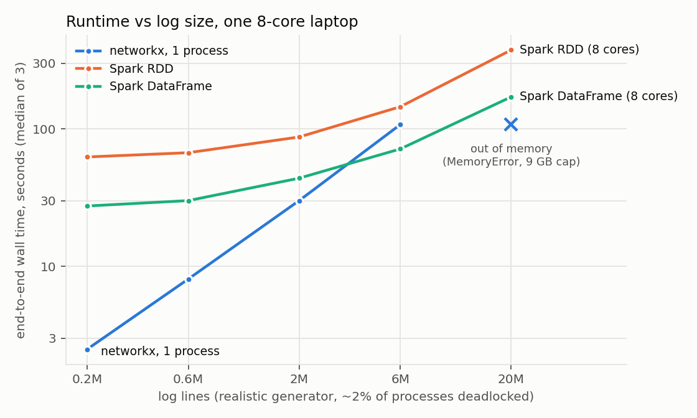
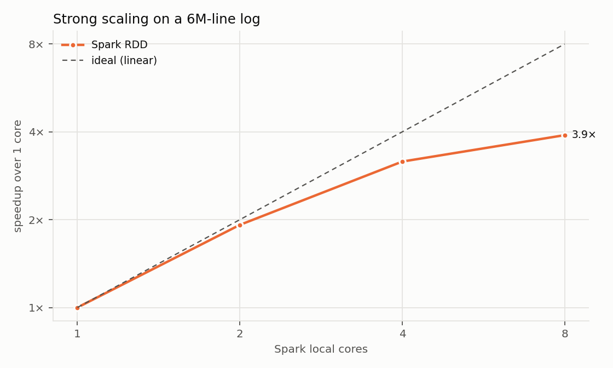
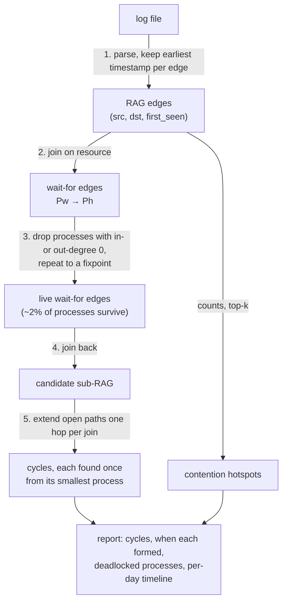

# Spark Deadlock Detector

[](https://github.com/ChaitanyaShah21/spark_deadlock_detector/actions/workflows/ci.yml)

Finds every deadlock in a large resource-allocation log with PySpark.
The log becomes a Resource Allocation Graph (RAG). The pipeline then prunes the graph to the part that can contain a cycle, and enumerates every deadlock cycle with iterative distributed joins.
There are two Spark engines, the RDD API and DataFrames / Spark SQL, plus a single-process networkx baseline. All three produce identical answers, checked against generated logs with known ground truth.

## Results

On one 8-core ARM64 laptop (11 GB RAM, WSL2), on realistic generated logs where about 2% of processes are deadlocked:

<picture>
  <source media="(prefers-color-scheme: dark)" srcset="docs/figures/size_sweep_dark.png">
  
</picture>

| Log lines | networkx, 1 process | Spark RDD, 8 cores | Spark DataFrame, 8 cores |
|---:|---:|---:|---:|
| 0.2M (9 MB) | **2.5 s** | 62.5 s | 27.5 s |
| 2M (90 MB) | **30.1 s** | 87.3 s | 43.8 s |
| 6M (281 MB) | 107.5 s | 144.9 s | **71.5 s** |
| 20M (936 MB, 59,047 deadlocks) | out of memory (8.8 GB) | 374.4 s | **170.8 s** |

- **Spark does not win on small logs.** A single Python process is 11× faster at 0.2M lines, because Spark pays roughly 25–60 s of fixed cost (JVM start-up, plus 6 pruning rounds and 27 search hops, each made of several jobs).
- **The DataFrame engine overtakes the single process between 2M and 6M lines,** and it is the only way the 20M log finishes on this machine. The networkx process needs about 1.2 KB of RAM per log line.
- **DataFrames beat RDDs 2.2× at every size.** Most of the gain is in pruning (4.2× faster at 20M), where RDD lambdas paid to move every edge to a Python worker and back on every round.
- **Strong scaling is 3.9× from 1 to 8 cores** (6M lines, RDD engine). It flattens past 4 cores because the iteration loop on the driver is serial.

Every number is a median of 3 runs. Each run is a fresh process timed from outside, with its commit recorded and its output checked against ground truth.
The method, raw runs, per-stage splits and known distortions are in [BENCHMARKS.md](BENCHMARKS.md); the raw rows are in [benchmarks/results.csv](benchmarks/results.csv).
**Not measured:** a leaner single-process baseline (integer ids, scipy), which would likely fit 20M lines, and any multi-machine cluster.

<details>
<summary>Core scaling plot</summary>

<picture>
  <source media="(prefers-color-scheme: dark)" srcset="docs/figures/core_sweep_dark.png">
  
</picture>
</details>

## How it works

Each log line is a timestamped event. `WAIT P R` means process P requests resource R (edge `P → R`); `HOLD P R` means P has been granted R (edge `R → P`).
With single-instance resources, a set of processes is deadlocked exactly when the RAG contains a cycle `P → R → P → … → P`.



1. **Parse.** Tab- or space-separated lines, with `HOLD` in either order; malformed lines are skipped. Duplicate edges collapse to their first appearance.
2. **Wait-for graph.** A join on the resource turns `Pw → R` plus `R → Ph` into `Pw → Ph`.
3. **Prune.** A process with no incoming or no outgoing wait-for edge cannot be on a cycle, so it is removed. Removing it can strand others, so this repeats until nothing changes. It never removes a deadlocked process.
4. **Candidate subgraph.** Only RAG edges on surviving wait-for edges go into the search.
5. **Cycle search.** One open path is seeded per `P → R` edge, and each round extends every path by one hop with a join. A path may only visit processes that sort after its first one, so each cycle is found exactly once.

The search is bounded by `--max-cycle-length`. If the frontier exceeds `--max-paths`, the search stops and the report flags the result as possibly incomplete.

## Key design rationales

| Decision | Instead of | Why |
|---|---|---|
| **Fixpoint degree pruning** | Connected components capped at 10 rounds (the first version) | It is exact: it never drops a deadlocked process, needs no iteration cap, and peels off every chain that feeds into a cycle. The original's cap could drop real cycle members. |
| **Each cycle enumerated once, from its smallest process** | Find every rotation, deduplicate at the end | The frontier would be k times larger for a k-process cycle, with deduplication on the driver. |
| **Explicit partition counts on every RDD shuffle** | PySpark defaults | A PySpark `join` is `cogroup` = `union` + `groupByKey`, which defaults to the partition count of the *union*. In an iterative loop, tasks per round grew 320 → 1,440 → 7,040 → 35,040. A test now guards against it. |
| **DataFrame engine with SQL-expression parsing** | A Python UDF wrapping the same parser | A UDF ships every line to a Python worker and back, which is the cost the rewrite removes. A test proves the SQL and Python parsers agree on edge cases. |
| **AQE (adaptive query execution) picks join strategies** | Hand-written `broadcast()` hints | It decides from actual sizes at run time; a wrong hint would broadcast a large frontier to every executor. In the pruning rounds it kept sort-merge joins (the survivor set exceeds the broadcast threshold) and coalesced shuffle partitions. The 2.2× comes from running in the JVM, not from a change of join strategy. |
| **Benchmarks on a generator with ground truth** | Scaling up a toy generator | The first generator put every process in a cycle, so pruning had nothing to do. The realistic one plants cycles of 2–10 processes, hubs, shared paths, bridges, retries and malformed lines, and writes out every expected cycle. |
| **networkx as the baseline** | A hand-written DFS, or Spark with 1 core | An independent, well-known implementation. Spark with 1 core would measure Spark's overhead, not the alternative to Spark. |

The full decision log, with the cost of each rejected option, is in [ARCHITECTURE.md](ARCHITECTURE.md).

## Project structure

```
src/deadlock_detector/
  parsing.py      line -> event -> RAG edge
  graph.py        RDD engine: RAG, wait-for join, fixpoint pruning, candidate subgraph
  cycles.py       RDD engine: distributed cycle enumeration
  detector.py     RDD pipeline, report, Spark session
  df_engine.py    the same pipeline in DataFrames / Spark SQL
  baseline.py     single-process networkx baseline
  cli.py          command line
scripts/
  generate_realistic_log.py   benchmark logs + ground-truth JSON
  generate_log.py             the original synthetic generator (every process deadlocked)
  benchmark.py                timed runs, checked against ground truth -> benchmarks/results.csv
  plot_benchmarks.py          docs/figures/
tests/            both engines on every test, brute-force cross-check, ground-truth checks
```

## Quick start

Requires Python 3.9+ and **Java 8, 11 or 17**. Spark 3.4 does not start on Java 21+ (`getSubject is not supported`).

```bash
python -m venv .venv && source .venv/bin/activate
pip install -e '.[dev]'
export JAVA_HOME=/usr/lib/jvm/java-17-openjdk-amd64    # if your default java is newer

deadlock-detector data/sample.log                       # RDD engine, all local cores
deadlock-detector LOG --engine df -c 8 --json report.json -v
deadlock-detector-baseline LOG                          # single process, networkx

python scripts/generate_realistic_log.py --lines 2000000 -o data/generated/real_2m.log
python scripts/benchmark.py spark-df data/generated/real_2m.log --cores 8 --runs 3
pytest                                                  # about 3.5 min, mostly Spark start-up
```

```
$ deadlock-detector data/sample.log
Deadlocks: 3 cycle(s)
  P101 -> R002 -> P106 -> R006 -> P101   (formed 2025-10-31 21:07:56)
  P105 -> R003 -> P107 -> R007 -> P105   (formed 2025-11-02 12:07:56)
  P102 -> R005 -> P103 -> R009 -> P108 -> R004 -> P102   (formed 2025-11-02 00:07:58)
  deadlocked processes (7): P101 P102 P103 P105 P106 P107 P108
```

| Option | Default | |
|---|---|---|
| `--engine` | `rdd` | `rdd` or `df` (DataFrames / Spark SQL) |
| `-c, --cores` | all | local Spark cores |
| `--partitions` | 2 × cores | shuffle partitions |
| `--max-cycle-length` | 13 | longest cycle searched for, in processes |
| `--max-paths` | 200000 | stop the search if more open paths remain |
| `--top` | 5 | hotspots to list |
| `--json PATH` | | write the full report (every cycle) as JSON |
| `-v` | | per-stage progress |

## Origin

This started as an individual operating-systems course assignment. It was then rebuilt, debugged and benchmarked as a standalone project.
Against that first version, on its own synthetic logs, the rebuild is 4.2× faster at 210k lines (216.9 s → 51.2 s) with identical output ([BENCHMARKS.md §1](BENCHMARKS.md)).
The rebuild:
- replaced an inexact pruning heuristic;
- enumerates each cycle once rather than once per rotation;
- fixed partition counts that compounded in iterative joins.
